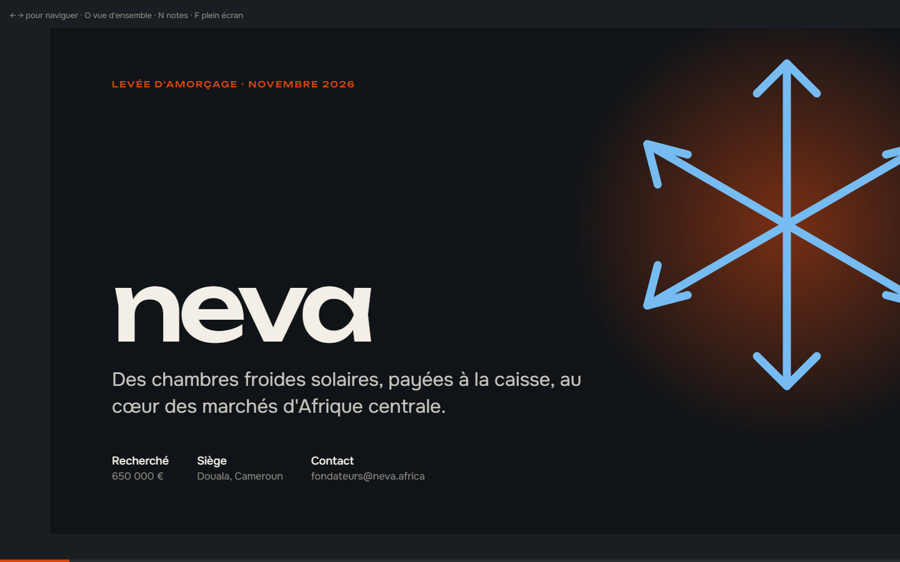
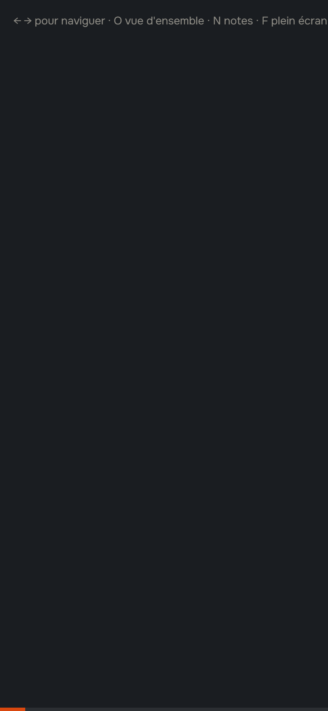

# Neva, pitch deck

**Pitch deck investisseurs (présentation web + PDF)** — Deck de levée d'amorçage de 13 diapositives pour une startup fictive de chambres froides solaires : narration problème → solution → marché → traction → modèle → équipe → levée, graphiques en SVG, moteur de présentation web et PDF prêt pour la data room.

**Démo en ligne : [https://lordlennyx.github.io/neva-pitch-deck/](https://lordlennyx.github.io/neva-pitch-deck/)**

Spot de présentation (30 s) : [media/spot-30s.mp4](https://lordlennyx.github.io/neva-pitch-deck/media/spot-30s.mp4)

## Ce que le projet montre

- 13 diapositives 16:9 : couverture, problème, solution, parcours, produit illustré, marché TAM/SAM/SOM, traction, unité économique, concurrence (matrice et tableau), équipe, projections, levée et usage des fonds, contact
- Graphiques SVG annotés (une série par graphique, valeurs clés étiquetées, info-bulles)
- Navigation clavier, clic et glissement tactile, lien direct vers chaque diapositive
- Vue d'ensemble (touche O), notes du présentateur avec chronomètre et diapositive suivante (touche N), plein écran
- Export PDF 1600 × 900 fidèle (media/neva-pitch-deck.pdf) et PNG de chaque diapositive

## Réalisation

- **Stack :** HTML, CSS, JavaScript natif, SVG ; export Playwright
- **Typographies :** Unbounded, Onest
- **Livrables :** media/neva-pitch-deck.pdf, media/diapos/*.png
- **Déclinable en :** PowerPoint, Keynote, Google Slides

| Bureau | Mobile |
|---|---|
|  |  |

---

Client et contenus fictifs, créés pour la démonstration. Conception, design et développement : **Njundiyimun Béchard** — [github.com/LordLennyx](https://github.com/LordLennyx)
